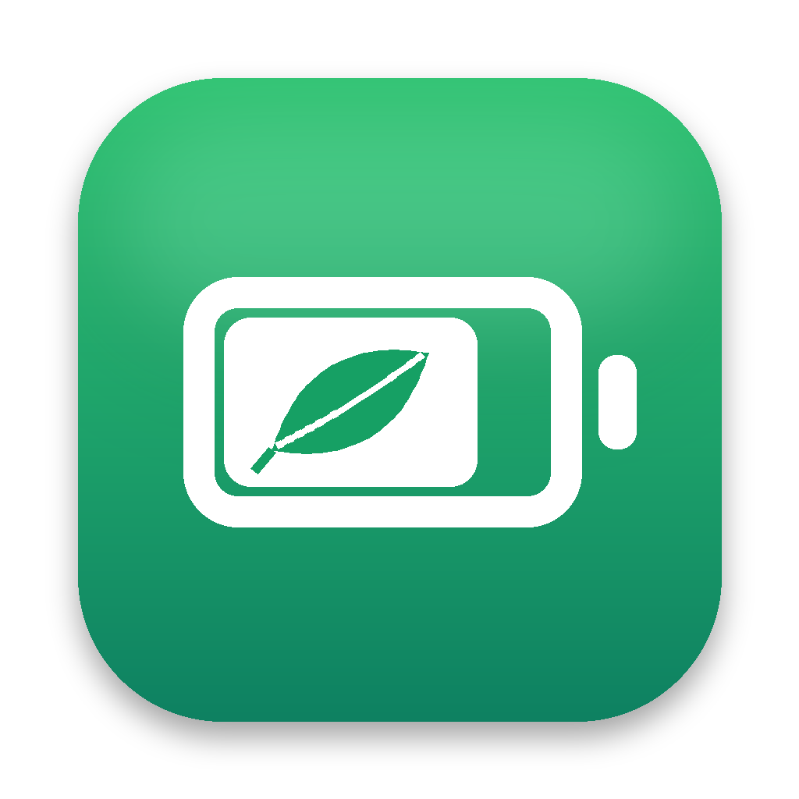
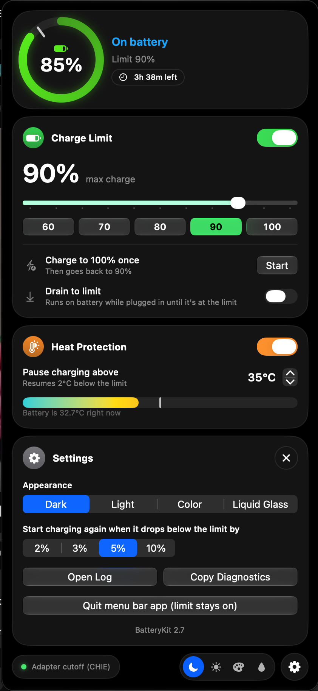

<p align="center">
  
</p>

<h1 align="center">BatteryKit</h1>

<p align="center">
  A free, open-source menu bar app that keeps your MacBook's battery at the charge limit you choose,<br>
  with heat protection and live battery and power stats.
</p>

<p align="center">
  
</p>

---

## Why

Lithium-ion batteries wear faster when they sit at 100% for long stretches, especially when warm. If your MacBook is plugged in most of the day, holding it at around 80% instead can noticeably slow down capacity loss.

macOS 26.4+ has a built-in Charge Limit (80–100%), but nothing more. BatteryKit gives you any limit from 50% to 100%, heat protection, a one-tap "charge to 100% once", and a detailed look at what your battery and Mac are doing.

## Features

- **Charge limit:** anything from 50% to 100%, set with a slider or one-tap presets.
- **Always on:**
  - A background service enforces the limit from boot, even before you log in, and keeps holding it while the Mac sleeps.
  - There's nothing to set up again after a restart.
- **Heat protection:** pauses charging when the battery gets too warm, at a temperature you choose.
- **Charge to 100% once:** before a long day away from a charger, then it goes back to your limit automatically.
- **Drain to limit:** if you're above your limit, it runs on battery while plugged in until you're back down.
- **Calibrate:** one tap charges to 100% once so macOS keeps its health and percentage readings accurate.
- **Live stats** (updated every 2 seconds while the panel is open), with clickable history charts:
  - Battery health (capacity now vs. new), cycle count, temperature, voltage
  - Watts coming in from the charger and watts the Mac is using
  - Which apps are using the most power, with the top 3 at any point in time
- **Four looks:** Dark, Light, Color, and Liquid Glass.
- **Built-in updater check and one-click uninstall.**

## Requirements

- A MacBook with **Apple silicon** (M1 or later). Intel Macs aren't supported.
- **macOS 26 (Tahoe) or later**
- Apple's **Command Line Tools**, which the installer offers to install if you don't have them
- An **admin account** (the background service needs it to control charging)

## Install

BatteryKit installs from source, so you can see exactly what you're running.

```bash
git clone https://github.com/preston100/BatteryKit.git
cd BatteryKit
bash install.sh
```

The installer builds the app, installs the background service, puts **BatteryKit** in your Applications folder and menu bar, and asks for your password once.

The first time you open the panel, a short setup screen walks you through the rest. The one important step is:

> **System Settings › Battery › ⓘ next to Charging:** turn **Optimized Battery Charging** off and set **Charge Limit** to **100%**.
> Otherwise macOS and BatteryKit fight over charging.

## Update

```bash
cd BatteryKit
git pull
bash install.sh
```

Your settings and history are kept. Settings › "Get Update" tells you when a new version is out.

## Uninstall

Use **Settings › Uninstall BatteryKit** in the app, or run:

```bash
bash uninstall.sh
```

Both remove everything and hand charging back to macOS.

## How it works

BatteryKit has two parts:

| Part | Runs as | Does |
|---|---|---|
| `batterykitd` | root, via a LaunchDaemon | Talks to the Mac's System Management Controller (SMC) to stop and start charging, every 10 seconds and on every plug/unplug, sleep and wake |
| `BatteryKit.app` | you, in the menu bar | Shows stats and saves your settings to `/Library/Application Support/BatteryKit/config.json` (only admin accounts can change it) |

On startup the service checks which charge controls your Mac's firmware still allows, and uses the best one:

1. **Charge inhibit** (`CHTE`, or `CH0B`/`CH0C` on older firmware): stops charging while the Mac keeps running on charger power.
2. **Adapter cutoff** (`CHIE`): on recent macOS versions, Apple removed or locked the keys above. BatteryKit then disconnects the charger in software at the limit, lets the battery "sail" down a few percent, then reconnects. The gap is adjustable in Settings.

If your macOS blocks every method, BatteryKit says so and still works as a battery and power monitor.

**Safety:**
- Charging always goes back to normal if the service stops or is uninstalled.
- BatteryKit never lets the battery run below 10% by itself.
- It reconnects the charger before sleep if the battery is low.

**Per-app power** is an estimate. macOS doesn't measure power per app, so BatteryKit splits the Mac's measured power draw using each app's Energy Impact score. Rankings are reliable; exact watts are approximate.

## Command line

```bash
batterykitd status        # what the service is doing right now
sudo batterykitd probe    # which charge controls your Mac allows
sudo batterykitd release  # hand charging back to macOS immediately
```

Logs: `/Library/Logs/BatteryKit.log`

## Known limitations

- When the Mac is fully **shut down** and plugged in, it charges to 100%, because nothing can run to stop it. This is the same for every app of this kind.
- After plugging in, macOS sometimes waits a minute or two before it starts charging. That's macOS, not BatteryKit.
- Low-wattage chargers (for example a 20 W phone charger) may not supply enough power to charge while the Mac is busy.
- Apple can change the SMC keys in any macOS update. If an update breaks charge control, BatteryKit falls back to monitoring and tells you.

## Disclaimer

BatteryKit controls your Mac's charging hardware through undocumented interfaces. It has been built and tested on a MacBook Air (M4) running macOS 27. Use it at your own risk; see the [license](LICENSE).

## License

[MIT](LICENSE) © 2026 Preston Andersen
